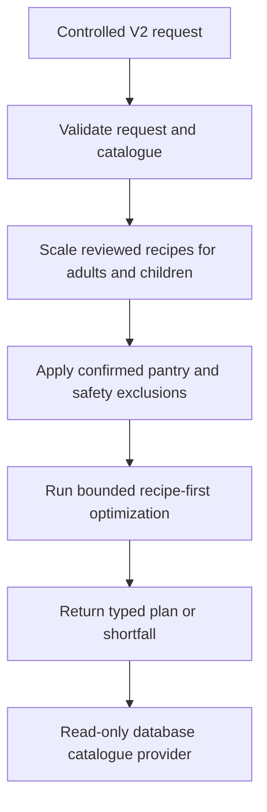
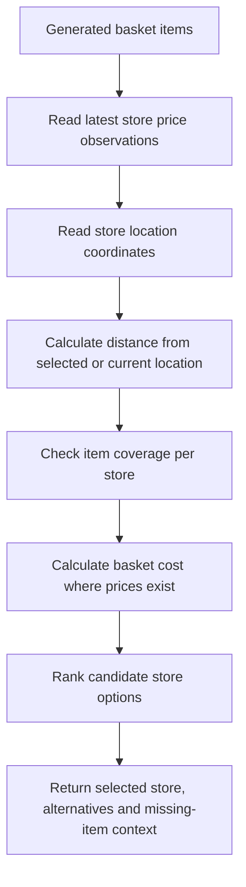

# Backend API Architecture

This document explains the WiseBasket FastAPI backend. It is intended for backend developers, data teammates and assessors reviewing the technical design of Iteration 2.

It covers API responsibilities, service boundaries, authentication, plan generation and store recommendation. It does not document every internal line of code; endpoint-level details are in the API contract.

## Technology Choice

| Technology | Why WiseBasket uses it |
| --- | --- |
| FastAPI | Provides typed Python endpoints, automatic OpenAPI docs and strong request validation. |
| Pydantic | Validates request/response models before data enters planner logic. |
| SQLAlchemy async | Keeps database access explicit and testable. |
| Alembic | Tracks database schema changes through migrations. |
| OR-Tools package | Supports deterministic recipe-first planning in the isolated V2 package. |
| PostgreSQL | Stores relational user, planning, food, nutrition, price and location data. |

## Backend Location

```text
services/api
```

Important areas:

| File or folder | Purpose |
| --- | --- |
| `app/main.py` | FastAPI app, routes and high-level orchestration. |
| `app/schemas.py` | Request and response schemas for auth, profile and plan persistence. |
| `app/db.py` | SQLAlchemy models and database engine setup. |
| `app/security.py` | Password hashing, JWT creation, refresh-token handling and role checks. |
| `app/services/` | Catalogue, pantry, recipe, receipt, location and pricing services. |
| `app/llm/` | Optional receipt-extraction LLM gateway; planner V2 does not use it. |

## Public Endpoint Groups

| Group | Endpoints | Purpose |
| --- | --- | --- |
| Health | `/health`, `/api/v1/health` | Basic service health and deeper data/backend status. |
| Food catalogue | `/api/v1/foods` | Returns optimizer-eligible foods from live PostgreSQL-backed candidates. |
| Authentication | `/api/v1/auth/register`, `/api/v1/auth/login`, `/api/v1/auth/refresh`, `/api/v1/auth/logout`, `/api/v1/auth/me` | User registration, login, refresh and session status. |
| Profile | `/api/v1/profile` | Stores a frontend-owned planning profile snapshot for signed-in users. |
| Retired planning boundary | `/api/v1/plans` | Returns HTTP 410 with `PLANNER_V1_RETIRED`. |
| Household | `/api/v1/households` | Stores and lists household records. |

Admin-only endpoints exist under `/api/v1/admin/*` for internal data review and diagnostics. They require an admin role and are not the main public user experience in this production-facing branch.

## Recipe-First Planning Status



`POST /api/v2/plans` is mounted with the read-only database catalogue provider.
It does not persist plans or call an LLM. Its response includes recipe
opportunity bundles for Worth considering; unpriced or excluded bundles fail
closed.

## Store Recommendation Flow



Iteration 2 uses deterministic rules and constraints for store recommendation. AI-based judgement about whether travel time is "worth it" is reserved for a later iteration.

## Error Handling

| Case | Backend response pattern |
| --- | --- |
| Invalid auth details | `401` or `403` with safe error detail. |
| Duplicate registration email | `409`. |
| Retired V1 planning request | `410` with `PLANNER_V1_RETIRED`. |
| Controlled V2 validation | `422` for request errors; typed HTTP 200 shortfalls for planning outcomes. |
| Service health check | `200` when API is alive. |

## Optional LLM Boundary

The backend retains optional LLM support for receipt interpretation. Recipe-first
planning, quantities, budget decisions, substitutions and nutrition scoring are
deterministic and do not call an LLM.

## Iteration 2 pantry, recipe and receipt services

Household-owned pantry routes accept ingredient presence without quantity. Recipe suggestions read current `AVAILABLE` pantry records on each request and return both required-match counts for ranking and `ingredient_count` for the all-ingredient card badge. Recipe details include household-scaled sufficiency and supported substitutions.

Receipt upload dispatches to the Celery worker when a broker is configured, otherwise to inline extraction. Both paths consume inference `raw_text` and parser drafts, run optional full-text LLM extraction, validate extracted purchase drafts, then apply receipt-label cleanup and RapidFuzz food matching. Invalid LLM extraction falls back to deterministic parser drafts. Non-food classification applies in both paths. Confirmation controls pantry creation.

See [Iteration 2](../iteration-2.md) for fallback conditions, test commands and accuracy limitations.
