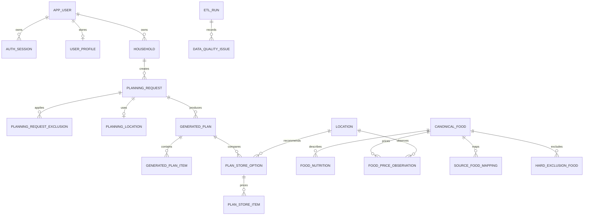
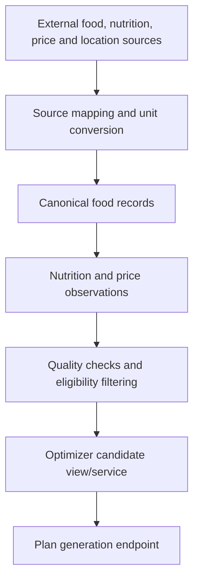

# Database Architecture

This document explains the WiseBasket PostgreSQL data model and migration approach. It is intended for backend developers, data teammates and assessors checking whether the build has a controlled data foundation.

It covers current Iteration 2 tables, data integrity rules and how source data becomes optimizer-ready. Field-level detail belongs in the data dictionary.

## Database Technology

WiseBasket uses PostgreSQL with SQLAlchemy models and Alembic migrations.

| Layer | Location |
| --- | --- |
| SQLAlchemy models | `services/api/app/db.py` |
| Alembic migration config | `config/alembic.ini` |
| Migration scripts | `migrations/versions/` |
| Data dictionary | `docs/reference/data-dictionary.md` |

## Conceptual Data Model

## Core Table Groups

| Group | Tables | Purpose |
| --- | --- | --- |
| User and auth | `app_user`, `auth_session`, `user_profile` | Accounts, session refresh tokens and saved app planning profile. |
| Household planning | `households`, `planning_request`, `planning_location`, `planning_request_exclusion` | Captures the context used to generate a plan. |
| Food master data | `canonical_food`, `food_alias`, `source_food_mapping`, `food_asset` | Maintains stable food IDs and maps external data into canonical records. |
| Nutrition data | `food_nutrition`, `rni_reference` | Stores nutrition values and selected nutrient reference information. |
| Price and location data | `location`, `food_price_observation` | Stores store/premise information and price observations. |
| Optimizer controls | `hard_exclusion`, `hard_exclusion_food`, `unit_conversion` | Controls eligibility, exclusions and edible/purchase unit conversion. |
| Generated outputs | `generated_plan`, `generated_plan_item`, `plan_store_option`, `plan_store_item` | Persists plan results, item costs and store comparison outputs. |
| Data quality | `etl_run`, `data_quality_issue` | Records source loading status and quality issues. |
| Pantry | `pantry_item` | Household-owned canonical food presence, source, availability and optional measured amount. |
| Recipes | `recipe_catalog`, `recipe_catalog_ingredient`, `recipe_cooking_step` | Active recipe definitions, required/optional ingredients, base portions and ordered instructions. |
| Receipts | `receipt`, `receipt_line` | Extraction lifecycle, expiring source images, ordered drafts, proposed food links and confirmation state. |

LLM `source_row_ids` are carried in the full-transcript extraction pipeline; they are not currently stored as a field on `receipt_line`. Likewise, `ingredient_count` is calculated for API responses and is not a recipe table column. OCR validation does not establish measured pantry quantity.

## Data Quality Rules

The database model uses constraints to reduce silent data errors:

- valid user roles and account statuses;
- positive household size;
- positive budget and planning days;
- latitude and longitude range checks;
- controlled quality status values such as `PASS`, `WARN` and `BLOCK`;
- non-negative prices and generated costs;
- explicit mapping review status before source records become trusted;
- uniqueness rules for source records and latest price lookup indexes.

## Optimizer-Ready Data Flow

## Migration Rules

- Database schema changes must be made through Alembic migrations.
- Migration filenames should describe the business purpose, not only the table name.
- Any new table used by planning should include constraints for impossible values.
- Data fixes that affect planner correctness should be documented through migrations or data-quality notes.

## Production Notes

Railway PostgreSQL is expected to provide `DATABASE_URL`. The backend normalises Railway-style PostgreSQL URLs to the async SQLAlchemy driver and requires SSL for Railway proxy connections.
