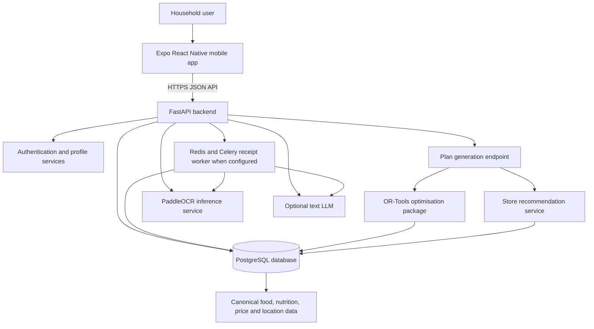
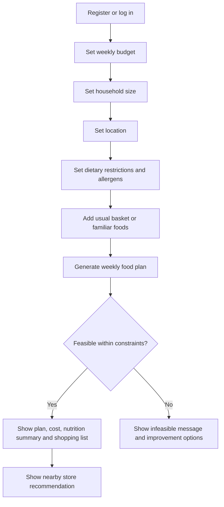

# System Overview

This document explains how WiseBasket works at a high level in Iteration 2. It is intended for mentors, assessors and new developers who need to understand the production-facing build without reading every source file.

It covers the mobile app, backend API, PostgreSQL, optimisation package, receipt worker and OCR inference service. See [Iteration 2](../iteration-2.md) for detailed current behaviour and known limitations.

## Product Goal

WiseBasket helps budget-constrained households generate a weekly food plan that respects hard budget and restriction constraints, then recommends a nearby store option using available price and location data.

The design is budget-first, then nutrition-aware. This means the system must never present a plan as feasible if the calculated basket cost exceeds the available weekly budget.

## Runtime Architecture

## Main Components

| Component | Non-technical role | Technical role |
| --- | --- | --- |
| Mobile app | Collects household details and shows plan results in a phone-friendly journey. | Expo React Native app under `apps/mobile`; uses typed API clients, local state, secure token storage and screen-based navigation. |
| FastAPI backend | Receives requests, checks accounts, validates inputs and returns food plans. | Python API under `services/api`; exposes `/api/v1/*` endpoints, Pydantic schemas, SQLAlchemy database access and service-layer orchestration. |
| Optimisation package | Finds a realistic basket that fits the user's money and restrictions. | Shared package under `packages/optimizer`; uses deterministic optimisation logic and model classes for plan requests, plan responses, store quotes and substitutions. |
| PostgreSQL | Stores user accounts, food data, prices, nutrition records, locations, planning requests and generated plans. | SQLAlchemy models in `services/api/app/db.py`; migrations managed by Alembic in `migrations/`. |
| Data/reference layer | Converts messy food, nutrition, price and location source data into planner-readable records. | Canonical data tables, source mappings, unit conversions, quality status fields and optimizer candidate views. |
| Railway backend deployment | Hosts backend services for phone builds. | API builds from `services/api/Dockerfile`; verify Railway service settings and compatibility with worker/inference releases. |

## Iteration 2 User Flow

## Design Principles

| Principle | Why it matters |
| --- | --- |
| Budget is a hard constraint | The target users may not have spare money to absorb recommendation errors. |
| Restrictions are hard exclusions | Allergens, religious restrictions and strong dietary exclusions must be removed before planning. |
| Planning is deterministic | The same data and inputs should produce repeatable results, which supports testing and mentor verification. |
| AI is not responsible for numbers | Iteration 2 avoids free-text AI for cost, nutrition and store calculations because these must be auditable. |
| Data quality is explicit | Source mappings, quality status fields and candidate filtering prevent uncertain data from silently entering the planner. |

## Current Production Boundary

The production-facing repository exposes the mobile app, FastAPI backend, database migrations, shared packages, tests, deployment config and documentation.

Some backend admin endpoints remain available for internal data maintenance and diagnostics, but the admin dashboard UI is not part of the current production-facing branch.

## Key Risks

| Risk | Current handling |
| --- | --- |
| Incomplete price coverage by store | Store options include item availability, missing items and coverage ratio. |
| Location precision issues | User location is validated and compared against known store coordinates. |
| Source-data mismatch | Canonical mapping and data-quality tables separate raw source values from optimizer-ready records. |
| Slow provider or OCR requests | Calls have separate time budgets and parser fallbacks; numeric planning remains deterministic. |
| iOS distribution constraints | Expo can preview and build iOS artifacts, but broad physical-device distribution may require Apple account/TestFlight decisions. |

## Pantry and receipt journey

Receipt capture leads to extraction, matched/unmatched row review, correction and user confirmation before pantry writes. Recipe “Have it” saves ingredient presence without requiring quantity. Updated pantry state refreshes suggestions. Badges count all listed ingredients, while current ranking prioritises main and required ingredient matches rather than the displayed fraction.
