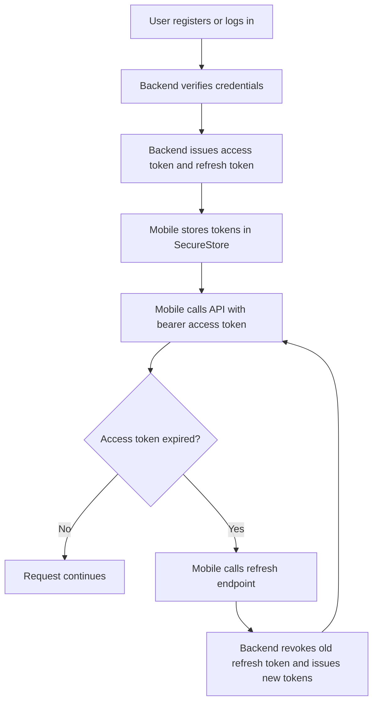

# Security Notes

This document summarises the current WiseBasket security controls and production risks. It is intended for developers, deployment owners and assessors.

The full academic security discussion belongs in the Google Drive `7.0 Security Aspects` folder. This repository note focuses on implemented controls and practical safeguards.

## Implemented Controls

| Area | Current control |
| --- | --- |
| Password storage | Passwords are hashed before storage. |
| Session handling | Access tokens and refresh tokens are issued after login/register. |
| Refresh token rotation | Refresh tokens are rotated on refresh and old sessions are revoked. |
| Mobile token storage | Mobile app uses Expo SecureStore. |
| Role protection | Admin endpoints require admin role checks. |
| Environment secrets | Backend secrets are loaded from environment variables. |
| Production secret validation | Non-development startup rejects default/weak `JWT_SECRET`, missing production database configuration and unsafe local CORS origins. |
| CORS | Allowed origins are controlled through `CORS_ORIGINS`; production must not use localhost, loopback or wildcard origins. |
| Input validation | Pydantic schemas validate API input before service logic. |
| Database integrity | PostgreSQL constraints block invalid core values such as negative prices and impossible coordinates. |

## Secret Handling Rules

- Do not commit `.env`.
- Do not put database credentials, JWT secrets or API keys in mobile app `.env` files.
- Only use `EXPO_PUBLIC_` variables for values that are safe to expose in a mobile bundle.
- Railway production variables must be set in Railway, not hardcoded in source files.
- Rotate `JWT_SECRET` and API keys if they are exposed.

## Authentication Flow

## Main Risks And Mitigations

| Risk | Mitigation |
| --- | --- |
| Weak production JWT secret | Backend validation rejects `change-me` outside development. |
| Mobile public env confusion | Mobile app requires explicit `EXPO_PUBLIC_API_BASE_URL`. |
| Admin endpoints exposed accidentally | Admin routes require role checks; public app does not include admin dashboard UI. |
| CORS too broad | Production startup rejects localhost, loopback and wildcard origins; restrict `CORS_ORIGINS` to required public origins. |
| Data poisoning or wrong source mapping | Use source mapping, quality status and review fields before data becomes optimizer-ready. |
| Location privacy | Only collect location when needed for planning and avoid storing unnecessary precision beyond the planning context. |

## Remaining Security Work

- Confirm production CORS origins after the final public app route is chosen.
- Add rate limiting or abuse protection before wider public release.
- Review token expiry values after real usage testing.
- Keep security test evidence under `testing/security/` and the formal 7.0 report.
